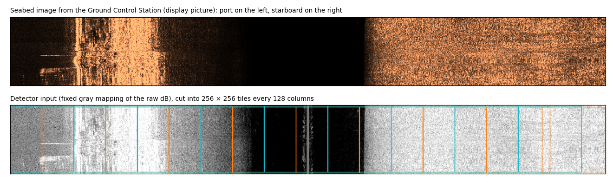

# BlueBoat-Perception

Finds objects in the side-scan sonar seabed images of the BlueBoat survey. It is the project's
**only detection source**: the Ground Control Station (GCS) draws its detections and runs no
detector of its own, and the belief map (BlueBoat-Belief) reads its results.



*Top: a seabed image as the GCS makes it, from a real harbour recording. It is 256 pings tall and
2400 samples wide, squeezed here to fit the page: port on the left, starboard on the right, the
dark band in the middle is the water under the boat. Bright marks on the port side are a quay.
Bottom: the same image as the detector sees it (a fixed grey mapping of the raw sonar levels), cut
into 256 × 256 tiles that overlap by half. The YOLO detector runs on each tile and the boxes are
merged back into one picture.*

> **Today the default detector is a dummy** (one point per image), and the YOLO detector is built
> but **has no trained weights yet**. Scores are **not probabilities**: calibration is not done,
> so every record says `calibrated: false`.

## What you can do with it

- **Run live** beside the GCS: every seabed image in, detections out on the GCS map, and one record
  per image saying what was searched and what was found.
- **Make training datasets from the simulator** (dataset mode): images with YOLO labels computed
  from the rendered picture and the world's object list.
- **Re-run the whole pipeline offline** on a recorded session, with the same result as live.
- **Train and evaluate YOLO models** (YOLO11s, YOLO26s) on tile datasets split by world.
- **Switch detector** (dummy or YOLO) and detector settings without changing code.

## How it connects to the other modules

```
sonar (BlueBoat-SSS seabed images) → [ Perception ] → Belief → Replanner → Control
```

| Module | Link | Relation to Perception |
|---|---|---|
| BlueBoat-SSS | [github.com/Kyyrron/BlueBoat-SSS](https://github.com/Kyyrron/BlueBoat-SSS) | The GCS sends every seabed image here and draws the detections that come back |
| BlueBoat-Belief | [github.com/Kyyrron/BlueBoat-Belief](https://github.com/Kyyrron/BlueBoat-Belief) | Reads the detections and the image records (which pings were searched) |
| BlueBoat-SSS-Sim | [github.com/Kyyrron/BlueBoat-SSS-Sim](https://github.com/Kyyrron/BlueBoat-SSS-Sim) | Its worlds and ground truth label the simulated training datasets |
| BlueBoat-MCS | [github.com/Kyyrron/BlueBoat-MCS](https://github.com/Kyyrron/BlueBoat-MCS) | The Mission Control Station (MCS) starts this node with real-boat and world launches |
| SSS-Dataset-Aug-Studio | [github.com/Kyyrron/SSS-Dataset-Aug-Studio](https://github.com/Kyyrron/SSS-Dataset-Aug-Studio) | Optional: augments the datasets made here |
| Whole project | [github.com/Kyyrron/BlueBoat-SideScanSonar](https://github.com/Kyyrron/BlueBoat-SideScanSonar) | The superproject that holds every module |

Inside the module, one seabed image goes through:

```
seabed image (raw dB + picture + metadata) → join → detector input (fixed gray)
  → detector (dummy, or YOLO over tiles) → calibration (none yet) → position on the map
  → /sss_ai/detections  +  one record per image on /sss_ai/image_records
```

Everything runs on the operator laptop, like every node of the project.

## Dependencies

| Dependency | Link | Quick install |
|---|---|---|
| Ubuntu 24.04, ROS 2 Jazzy | [docs.ros.org](https://docs.ros.org/en/jazzy/Installation/Ubuntu-Install-Debs.html) | `sudo apt install ros-jazzy-desktop` |
| ROS packages | apt | `sudo apt install ros-jazzy-vision-msgs ros-jazzy-ros2bag` |
| numpy, OpenCV, PyYAML | superproject `requirements.txt` | `sudo apt install python3-opencv python3-yaml` or `pip install -r requirements.txt` |
| YOLO only: Ultralytics and PyTorch | [docs.ultralytics.com](https://docs.ultralytics.com/quickstart/) | `pip install ultralytics` (brings PyTorch) |
| BlueBoat-SSS | [README](https://github.com/Kyyrron/BlueBoat-SSS) | the source of the seabed images |

Ultralytics and PyTorch are not needed for the dummy detector and are not in `requirements.txt`.
Install them only if you use YOLO, in the Python that runs the node.

## Installation, step by step

```bash
# 1. Get the project with its submodules (or clone https://github.com/Kyyrron/BlueBoat-Perception alone)
mkdir -p ~/ros2_ws/src && cd ~/ros2_ws/src
git clone --recurse-submodules https://github.com/Kyyrron/BlueBoat-SideScanSonar.git

# 2. ROS packages
sudo apt install ros-jazzy-vision-msgs ros-jazzy-ros2bag python3-opencv python3-yaml

# 3. Build (the package sits one folder below the repository: blueboat_perception/)
cd ~/ros2_ws && source /opt/ros/jazzy/setup.bash
colcon build --packages-select blueboat_perception

# 4. Every new terminal
cd ~/ros2_ws && source env.sh       # env.sh: "source .venv/bin/activate" + "source install/setup.bash"

# 5. Optional, for YOLO
pip install ultralytics
```

## Check the installation

```bash
# 1. The tests (system Python, without sourcing the workspace: the venv has no pytest)
cd ~/ros2_ws/src/BlueBoat-SideScanSonar/BlueBoat-Perception/blueboat_perception
PYTEST_DISABLE_PLUGIN_AUTOLOAD=1 /usr/bin/python3 -m pytest

# 2. The node starts
cd ~/ros2_ws && source env.sh
ros2 launch blueboat_perception perception_launch.py
# in another terminal: its status, once per second
ros2 topic echo --once /sss_ai/perception/status std_msgs/msg/String \
    --qos-durability transient_local --qos-reliability reliable
```

## Tips: when to use it, what to know

- **Normally the Mission Control Station starts this node** for real-boat runs and for simulations
  in a built world. Start it by hand for dataset mode or tests.
- **Use `use_sim_time:=true` in a simulation**, `false` on the real boat.
- **The dummy detector searches nothing.** With it, Belief correctly reports zero coverage. Real
  results need trained YOLO weights.
- **One record per image, always.** `detections: []` means "searched, nothing found"; `null` means
  "could not search".
- **A score is not a probability** until a calibration exists (`calibrated: true`).
- **Labels come from the rendered picture and the world metadata**, never from the simulator's
  contacts, and the simulator's ground truth never reaches the live detections.
- **Split datasets by world, never by image, and never tune on the test worlds.** Every detector
  result is stated "on simulated data", following the superproject's `SIM_VALIDITY_CONDITIONS.md`.
- **Nothing is ever overwritten**: a name already taken gets `-2`, `-3`. A recording session is only
  read.

## More documentation

| Document | What you find there |
|---|---|
| [docs/USER_GUIDE.md](docs/USER_GUIDE.md) | Live, dataset and offline modes, settings, training and evaluating YOLO, output files |
| [docs/DEVELOPMENT.md](docs/DEVELOPMENT.md) | How to work on this module: Claude Code, setup, tests, rules, next steps |
| [docs/topics.md](docs/topics.md) | The interface contract: topics, record fields, parameters |
| [docs/DESIGN.md](docs/DESIGN.md) | Why the pipeline is built this way (tiling, merging, labels) |
| [docs/PREPROCESSING_STUDY.md](docs/PREPROCESSING_STUDY.md) | The study behind the detector input, and its decisions |
| [docs/LIVE_CHECKS.md](docs/LIVE_CHECKS.md) | Live checks and the real-boat command sheet |
| [docs/REFERENCES.md](docs/REFERENCES.md) | The literature behind every non-software choice |
| [docs/REQUESTS.md](docs/REQUESTS.md) | What this module asked of its neighbours |
| [GCS side](../BlueBoat-SSS/blueboat_sss/blueboat_gcs/docs/PERCEPTION_INTEGRATION.md) | How the GCS makes and sends the seabed images |

Licence: Apache-2.0.
